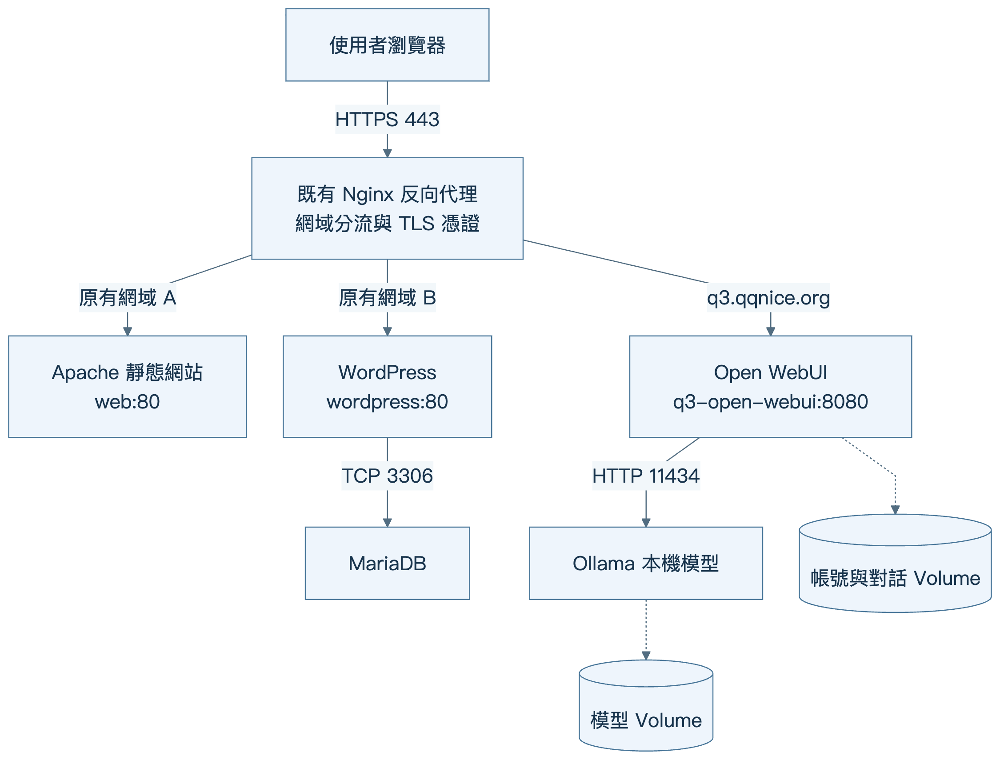
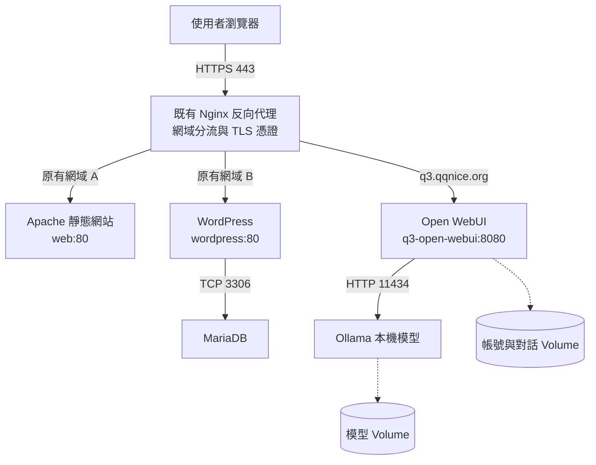
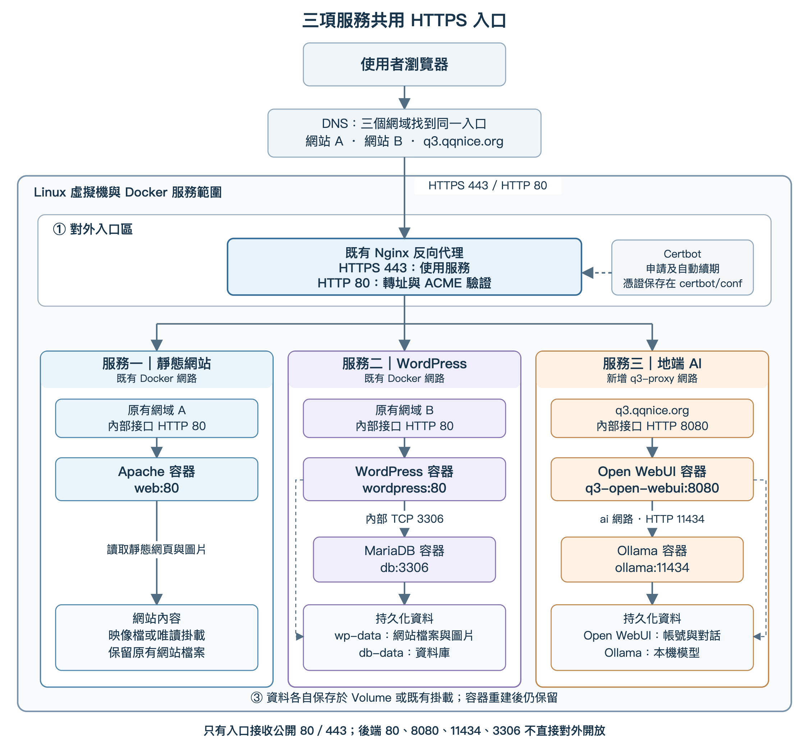
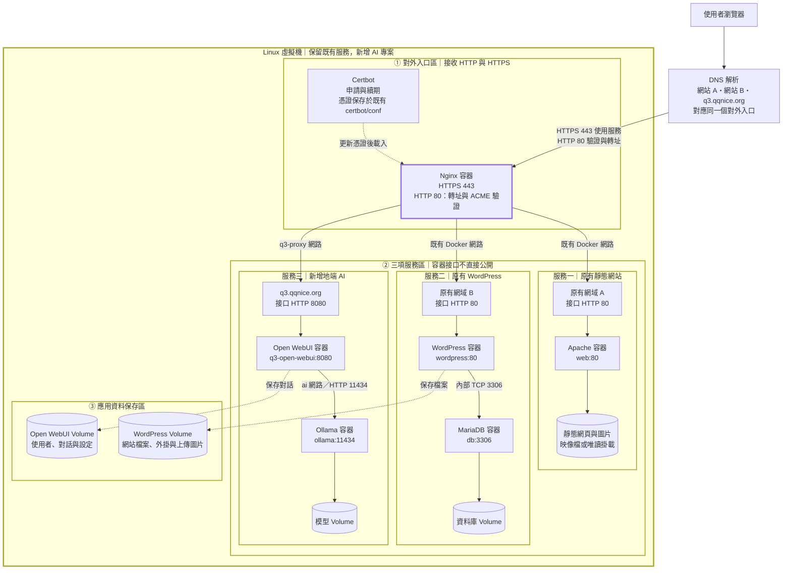

# 部署操作參考手冊（離線副本）

本儲存庫版本將示範模型調整為 gemma3:1b；與原始 Notion 手冊的 Qwen 範例不同。

來源：[Notion 完整部署手冊](https://app.notion.com/p/407efa09c19681ee8fb5d78abdd37a0f)，文件日期 2026-10-28。

本檔供 VM 上 Codex 查閱設定範例。以 [CODEX_TASK.md](CODEX_TASK.md) 的本次任務與實機盤點結果決定實作；本檔不代表伺服器已安裝完成。兩張圖已附在本包，不需登入 Notion。

---

在既有 Linux 虛擬機上，保留原本兩個網站與 NAS 服務，新增 Ollama 與 Open WebUI，透過 **https://q3.qqnice.org** 提供具有帳號登入及有效 HTTPS 憑證的地端 AI 服務。本筆記主線沿用 WEEK2／WEEK3 的 Docker Nginx 與 Certbot，其他入口配置放在獨立分支。

> 適用範圍：Ubuntu 24.04、已可正常使用 Docker Compose 的既有主機。這是一份部署操作手冊；完成狀態以本頁的實機驗收表為準。發佈前的文件檢查不等於已在目標 VM 安裝完成。

閱讀順序：先盤點與選分支，再依實機執行；主提示詞為 [CODEX_TASK.md](CODEX_TASK.md)。

# 1 課程目標與既有進度

完成後，你應能說明瀏覽器如何經過 DNS、反向代理、Open WebUI 到達 Ollama；也能區分主機 Port、容器 Port、Docker 網路、資料 Volume 與憑證。

本次新增兩個容器，對使用者提供的是第三項網站服務：

| 使用者看到的服務 | 網站程式 | 內部後端 | 對外入口 |
| --- | --- | --- | --- |
| 原有靜態網站 | Apache | 網站檔案 | 原有網域，HTTPS 443 |
| 原有 WordPress | WordPress | MariaDB | 原有網域，HTTPS 443 |
| 新增 AI 聊天網站 | Open WebUI | Ollama | q3.qqnice.org，HTTPS 443 |

## 1.1 本次與舊教材的關係

| 資料 | 教材記錄的架構 | 本次如何使用 |
| --- | --- | --- |
| Docker 兩網站分階段講義 v2 | 主機 Apache，代理至 Docker 的 8080、8081 | 主機 Apache 分支的背景 |
| WEEK2 Docker Compose 雙網站部署 | Docker Nginx、Apache、WordPress、MariaDB、Certbot | 本次主線架構 |
| WEEK3／WEEK4 備份與主機安全 | Volume 備份、還原、SSH、防火牆與排程 | 延續既有維護方式，另外補上 AI 資料 |
| 較早的 Linux Azure Ollama 筆記 | 主機 Ollama、Docker WebUI，直接使用 11434／3000 | 屬於另一種部署方式，本次不混用其公開 Port 指令 |

既有教材：

- [WEEK2 Docker Compose 雙網站部署實戰](https://app.notion.com/p/4afefa09c19682b09bc9810ae372791b)
- [WEEK3 修正版 v2.1 備份還原與主機安全](https://app.notion.com/p/3f9efa09c19681569a81dae455926535)
- [WEEK4 QQ 備份自動化與主機安全](https://app.notion.com/p/a78efa09c19683c0ab4e81c9b0329274)
- [較早的 Linux Azure Ollama 與 Open WebUI 筆記](https://app.notion.com/p/33defa09c1968084a4eff550bd445425)

這些文件證明課程設計，不能代替目前 VM 的狀態。下方第一個工作是盤點，不是重新安裝 Docker、停掉 Apache 或清空既有專案。

## 1.2 學生紀錄方式

每完成一個階段，在自己的筆記留下：執行位置、指令、預期結果、實際結果、錯誤與修正、檢查點證據。截圖保留必要的服務與 Port 資訊，不放密碼、私鑰或完整 .env。

所有標示為 bash 的區塊都可使用 Notion 的複製按鈕。設定檔採用 bash 的 heredoc 寫入，連同起訖標記一起複製；不要只複製中間幾行。第 11 章的排程內容須貼進 crontab 編輯器；Mermaid 圖表原始碼及第 15 章的 YAML 設定片段也不能直接貼進終端機執行。

每個區塊都要讀結果後才執行下一段。括號內的 set -euo pipefail 只保護該區塊；某段失敗不會阻止你手動貼下一段。

# 2 先看兩張架構圖

## 2.1 簡圖：三項網站服務共用入口



#### 展開可編輯的 Mermaid 架構原始碼



## 2.2 分區圖：入口、三項服務、接口與資料

圖中的網站 A、B 代表實機原有網域。WEEK2 示範值為 k1.kknice.net 與 q1.qqnice.org，請以你的 Nginx 設定為準。這張圖的 NAS 不另畫成公開入口，因為尚未確認它是檔案服務、Nextcloud，還是位於 VM 前方的反向代理；若屬於後者，改走第 13 章。



#### 展開可編輯的 Mermaid 架構原始碼



DNS 只決定連到哪個 IP；TLS 連線使用網域名稱選擇憑證，Nginx 再依請求的網站名稱分流。只有入口需要接收公開 80／443，三項服務可以共用這組 Port。

## 2.3 接口對照表

| 來源 | 目的 | 實際接口 | 是否公開到 Internet |
| --- | --- | --- | --- |
| 瀏覽器 | Nginx | 主機 TCP 443 | 是，依原網路政策 |
| ACME 驗證／HTTP 瀏覽器 | Nginx | 主機 TCP 80 | HTTP-01 需要外部可達 |
| Nginx | 靜態網站 | web:80 | 否 |
| Nginx | WordPress | wordpress:80 | 否 |
| WordPress | MariaDB | db:3306 | 否 |
| Nginx | Open WebUI | q3-open-webui:8080 | 否 |
| Open WebUI | Ollama | ollama:11434 | 否 |

主線中的 Ollama 及 Open WebUI 都不設定 ports。設定 expose 或映像檔內的 EXPOSE 也不等於發布主機 Port。容器裡的 127.0.0.1 指向該容器自己，不是 Linux 主機。

# 3 STEP 0 盤點主機並選擇分支

## 3.1 確認操作位置

【自己的電腦】使用原本能成功登入的帳號、位址及金鑰。不要因為 q3 的 DNS 尚未建立就改用它登入。

```bash
# 將帳號與位址換成既有 SSH 連線資料。
ssh 你的帳號@既有VM位址
```

【目標 Linux VM】後續指令以 Bash 執行。如果目前不是 Bash，先輸入：

```bash
bash
```

再確認身分與主機：

```bash
whoami
hostname
pwd
cat /etc/os-release
uname -m
timedatectl
```

通過：確認這就是承載原有網站的 VM；記下系統版本、CPU 架構與時區。不要在本機 Mac 或另一台空白 VM 執行後面的部署指令。

## 3.2 確認 Docker 與入口

```bash
docker context show
docker version
docker compose version
docker compose ls
docker ps --format 'table {{.Names}}\t{{.Image}}\t{{.Status}}\t{{.Ports}}'
sudo ss -ltnp | grep -E ':(80|443|3000|8080|8081|11434)\b' || true
systemctl is-active apache2 nginx docker || true
```

docker version 需能讀到 Server；context 不應意外指向其他 Docker 主機。ss 看不到 docker-proxy 不代表沒有發布 Port，還要一起看 docker ps 的映射。

| 看見的情況 | 選擇 |
| --- | --- |
| nginx 容器發布 80、443，且有 webstack 專案 | 主線：STEP 1 至 STEP 10 |
| 主機 apache2 正在接收外部 80、443 | 第 12 章，主機 Apache |
| 主機 nginx 正在接收外部 80、443 | 第 12 章，主機 Nginx |
| 80、443 的路由先進 NAS 的代理服務 | 第 13 章，NAS 前置入口 |
| 同時存在多層代理，或無法判斷 | 先列出「Internet → 哪台設備 → 哪個 Port → VM」，確認後才改設定 |

「有 NAS」不一定代表 NAS 管理 HTTPS。Nextcloud 作為網站程式、SMB 檔案分享、NAS 上的反向代理是不同角色。

## 3.3 資源檢查

```bash
free -h
nproc
df -h
docker system df
docker stats --no-stream
```

本筆記 CPU 範例給 Ollama 最多 2 個 CPU／6 GiB RAM，Open WebUI 最多 1 個 CPU／2 GiB RAM。以約 16 GiB RAM、4 vCPU 以上的 VM 作起始教學規劃，仍需扣除網站、資料庫、NAS 與系統的使用量；不能只看總容量。模型、上下文長度、文件解析與同時使用人數都會改變需求。

有 NVIDIA GPU 時再檢查：

```bash
command -v nvidia-smi >/dev/null && nvidia-smi
```

VM 看不到 GPU 時先採 CPU 路線。實體主機有顯示卡，不代表 VM 已配置 GPU 直通。

檢查點：

- [ ] 確認目標 VM、Docker context、既有 Compose 專案位置。
- [ ] 確認誰接收外部 80／443，以及 NAS 是否位於前面。
- [ ] 記錄原有網站網址，瀏覽器確認都可正常使用。
- [ ] 記錄可用 RAM、磁碟與 CPU，決定初始資源上限。

# 4 STEP 1 DNS 與原有服務基準

## 4.1 網域設定

建立 q3.qqnice.org 的 A 紀錄，指向真正對外入口的 IPv4。若用 CNAME，也必須最終解析到正確入口。既有網站的 DNS 與 Port forwarding 保持原有路徑。

只有實際具備正確 IPv6 路徑時才保留 AAAA；不要留下指向另一台主機或無法連線的舊 AAAA。若 DNS 業者提供 CDN／代理功能，應先確認其 ACME 與串流設定；本筆記主線假設 DNS 直接解析到既有入口。

【目標 VM】缺少基本檢查工具時才安裝：

```bash
sudo apt-get update
sudo apt-get install -y curl dnsutils openssl python3
```

檢查公開解析：

```bash
dig +short A q3.qqnice.org
dig +short AAAA q3.qqnice.org
dig +short CAA qqnice.org
```

若有 CAA 限制，必須允許使用的憑證機構。新名稱屬於 qqnice.org；既有憑證只有明確涵蓋 q3.qqnice.org，或具有適用的 *.qqnice.org 萬用名稱時才能沿用。新增網站名稱不要求更改 Linux hostname。

HTTP-01 驗證需要 Internet 能連到入口的 TCP 80；本機 hosts 檔不能代替公開 DNS。純內網或外部 80 不可達時，使用第 14 章的 DNS-01 路線。[Let’s Encrypt 驗證方式](https://letsencrypt.org/docs/challenge-types/)

## 4.2 保存原有服務基準

【自己的電腦】替換為兩個實際網址，分別檢查；Windows PowerShell 請用 curl.exe。

```bash
curl --fail --show-error --location --max-time 20 \
  --output /dev/null --write-out 'HTTP=%{http_code}\n' \
  https://你的原有靜態網站網域/

curl --fail --show-error --location --max-time 20 \
  --output /dev/null --write-out 'HTTP=%{http_code}\n' \
  https://你的原有WordPress網域/
```

另用瀏覽器確認網頁內容、圖片與既有登入功能；若有 NAS／Nextcloud，記錄它的可用狀態。後面每次改入口後都要重做比較。

# 5 STEP 2 備份與確認既有 webstack

以下主線限於：原本以 ~/webstack/compose.yml 管理、Docker Nginx 是公開入口、服務名稱為 nginx 與 certbot。若實際不同，先依 docker compose ls 校正路徑與名稱。

## 5.1 查看設定及掛載

```bash
(
set -euo pipefail
cd "$HOME/webstack"
test -f compose.yml
docker compose config --quiet
docker compose config --services
docker compose ps
nginx_id="$(docker compose ps -q nginx)"
test -n "$nginx_id"
docker inspect "$nginx_id" --format '{{json .Mounts}}'
docker inspect "$nginx_id" --format '{{json .NetworkSettings.Networks}}'
)
```

通過：nginx 正常執行，確認 conf.d、ACME 與憑證三組掛載對應：

| 主機目錄 | Nginx 容器目錄 | 用途 |
| --- | --- | --- |
| ~/webstack/nginx/conf.d | /etc/nginx/conf.d | 網站設定 |
| ~/webstack/certbot/www | /var/www/certbot | HTTP-01 驗證 |
| ~/webstack/certbot/conf | /etc/letsencrypt | 憑證、帳號及續期設定 |

需要查看完整設定時在 VM 本機查看，不把包含密碼的輸出貼到公開筆記。

```bash
cd "$HOME/webstack"
docker compose exec -T nginx nginx -T | less
```

確認 Nginx 在 http 區塊內載入 /etc/nginx/conf.d/*.conf。後面的 map 指令必須放在 http 層級，不能放在 server 內。

## 5.2 先備份

先使用 WEEK3 已驗證的流程完成網站與資料庫備份，確認檢查碼及離機副本。既有 backup.sh 可能短暫停止 WordPress，執行前安排合適時間。不要改成直接打包正在寫入的資料庫目錄。

另外保存入口設定快照：

```bash
(
set -euo pipefail
umask 077
cd "$HOME/webstack"
snapshot="$HOME/backups/pre-q3-$(date +%Y%m%d-%H%M%S)"
install -d -m 700 "$snapshot"
cp -a compose.yml "$snapshot/"
if [ -f .env ]; then cp -a .env "$snapshot/"; fi
for f in compose.override.yml compose.override.yaml; do
  if [ -f "$f" ]; then cp -a "$f" "$snapshot/"; fi
done
sudo tar -czf "$snapshot/proxy-and-certificates.tar.gz" nginx certbot
sudo chmod 600 "$snapshot/proxy-and-certificates.tar.gz"
printf '設定快照：%s\n' "$snapshot"
)
```

這是設定快照，不包含 WordPress 資料庫及 Named Volume，不能代替前面的網站備份。不要把備份放進網站可公開讀取的目錄。

# 6 STEP 3 建立共享網路且保留原有網路

Open WebUI 使用兩個網路：q3-proxy 供 Nginx 存取；ai 供它連到 Ollama。Ollama 只加入 ai。ai 是一般 bridge 網路，仍需能向外下載模型，不設定 internal: true。

## 6.1 建立 q3-proxy

```bash
(
set -euo pipefail
docker info >/dev/null
if docker network inspect q3-proxy >/dev/null 2>&1; then
  echo "q3-proxy 已存在，請先核對其用途與成員"
  docker network inspect q3-proxy
else
  docker network create q3-proxy
fi
)
```

同名網路若屬於其他用途，停止並先調整命名；不要刪除它。

## 6.2 為既有 Compose 加入增補檔

這一段只適用於原 nginx 使用預設 default 網路、且尚無 override／COMPOSE_FILE 自訂的 WEEK2／WEEK3 配置。用獨立增補檔加入網路，可避免覆寫原有 compose.yml。

先執行檢查，輸出 nginx 目前的網路與現有增補檔：

```bash
(
set -euo pipefail
cd "$HOME/webstack"
docker compose config --format json | python3 -c \
'import json,sys; d=json.load(sys.stdin); print("nginx networks:", d["services"]["nginx"].get("networks", {}))'
printf 'Shell COMPOSE_FILE=%s\n' "${COMPOSE_FILE-未設定}"
if [ -f .env ]; then grep -n '^COMPOSE_FILE=' .env || true; fi
find . -maxdepth 1 -type f -name '*override*' -print
)
```

若既有自訂網路、增補檔或 COMPOSE_FILE，請保留原設定，由教師合併 q3_proxy；不要執行下面的自動建立區塊，也不要把 default 當成所有環境都適用。

符合本節前提時：

```bash
(
set -euo pipefail
cd "$HOME/webstack"
test ! -e compose.override.yml
test ! -e compose.override.yaml
test -z "${COMPOSE_FILE-}"
if [ -f .env ] && grep -q '^COMPOSE_FILE=' .env; then
  echo "停止：.env 已指定 COMPOSE_FILE，需先確認載入方式" >&2
  exit 1
fi
cat > compose.override.yml <<'YAML'
services:
  nginx:
    networks:
      default: {}
      q3_proxy: {}

networks:
  default: {}
  q3_proxy:
    external: true
    name: q3-proxy
YAML
docker compose config --quiet
docker compose config --format json | python3 -c \
'import json,sys; d=json.load(sys.stdin); print("nginx networks:", d["services"]["nginx"]["networks"])'
)
```

預期包含 default 與 q3_proxy；兩個原有網站仍留在原網路。不要在這裡對 webstack 執行 down。

## 6.3 接上正在執行的 Nginx

增補檔保存的是日後重建時的設定；這一步把目前容器也接上，不必立刻重建入口。

```bash
(
set -euo pipefail
cd "$HOME/webstack"
nginx_id="$(docker compose ps -q nginx)"
test -n "$nginx_id"
if docker inspect "$nginx_id" \
  --format '{{json .NetworkSettings.Networks}}' |
  python3 -c 'import json,sys; sys.exit(0 if "q3-proxy" in json.load(sys.stdin) else 1)'
then
  echo "Nginx 已加入 q3-proxy"
else
  docker network connect q3-proxy "$nginx_id"
fi
docker inspect "$nginx_id" --format '{{json .NetworkSettings.Networks}}'
)
```

原有網路和 q3-proxy 都存在才通過。日後若用 docker compose up 重建 Nginx，會讀取增補檔；若既有腳本明確指定 -f compose.yml，必須同時納入增補檔，否則會漏掉新網路。

[Docker Compose 跨專案網路](https://docs.docker.com/compose/how-tos/networking/)；[多份 Compose 設定的合併規則](https://docs.docker.com/reference/compose-file/merge/)

# 7 STEP 4 建立獨立 AI 專案

## 7.1 建立目錄與初始密鑰

【目標 VM】以下只適用於新專案。若 .env、compose.yml 或同名 q3-llm 專案已存在，停止並確認是否先前已做過；不要直接覆蓋資料。

```bash
(
set -euo pipefail
umask 077
mkdir -p "$HOME/q3-llm"
chmod 700 "$HOME/q3-llm"
cd "$HOME/q3-llm"
test ! -e .env
test ! -e compose.yml
read -r -p "管理員電子郵件：" admin_email
if [[ ! "$admin_email" =~ ^[A-Za-z0-9._%+-]+@[A-Za-z0-9.-]+\.[A-Za-z]{2,}$ ]]; then
  echo "停止：請使用一般格式的電子郵件地址" >&2
  exit 1
fi
webui_secret="$(openssl rand -hex 32)"
admin_password="$(openssl rand -hex 24)"
{
  printf 'WEBUI_SECRET_KEY=%s\n' "$webui_secret"
  printf 'WEBUI_ADMIN_EMAIL=%s\n' "$admin_email"
  printf 'WEBUI_ADMIN_PASSWORD=%s\n' "$admin_password"
} > .env
chmod 600 .env
echo "密鑰與初始管理員設定已保存；不在畫面輸出"
)
```

WEBUI_SECRET_KEY 必須固定並備份，不要每次啟動都重新產生。初始管理員變數只在使用者資料庫為空時建立帳號，不能用來重設已存在的管理員。

## 7.2 寫入完整 Compose

下列版本於 2026-10-28 核對發布頁。正式環境固定版本，升級前先備份並看發布說明；不要直接換成 main、latest 後假設行為完全相同。

```bash
(
set -euo pipefail
cd "$HOME/q3-llm"
test -f .env
test ! -e compose.yml
cat > compose.yml <<'YAML'
name: q3-llm

services:
  ollama:
    image: ollama/ollama:0.40.12
    restart: unless-stopped
    cpus: "2.0"
    mem_limit: 6g
    environment:
      OLLAMA_HOST: "0.0.0.0:11434"
      OLLAMA_NO_CLOUD: "1"
      OLLAMA_NUM_PARALLEL: "1"
      OLLAMA_MAX_LOADED_MODELS: "1"
      OLLAMA_CONTEXT_LENGTH: "4096"
    volumes:
      - ollama-data:/root/.ollama
    networks:
      - ai
    healthcheck:
      test: ["CMD", "ollama", "list"]
      interval: 15s
      timeout: 10s
      retries: 10
      start_period: 30s
    logging:
      driver: json-file
      options:
        max-size: "10m"
        max-file: "3"

  open-webui:
    image: ghcr.io/open-webui/open-webui:v0.12.4
    restart: unless-stopped
    cpus: "1.0"
    mem_limit: 2g
    depends_on:
      ollama:
        condition: service_healthy
    environment:
      OLLAMA_BASE_URL: "http://ollama:11434"
      WEBUI_URL: "https://q3.qqnice.org"
      WEBUI_SECRET_KEY: ${WEBUI_SECRET_KEY:?請先建立密鑰}
      WEBUI_ADMIN_EMAIL: ${WEBUI_ADMIN_EMAIL:?請先設定管理員信箱}
      WEBUI_ADMIN_PASSWORD: ${WEBUI_ADMIN_PASSWORD:?請先設定初始密碼}
      ENABLE_SIGNUP: "false"
      CORS_ALLOW_ORIGIN: "https://q3.qqnice.org"
      WEBUI_AUTH_COOKIE_SECURE: "true"
      WEBUI_SESSION_COOKIE_SECURE: "true"
    volumes:
      - openwebui-data:/app/backend/data
    networks:
      ai: {}
      proxy:
        aliases:
          - q3-open-webui
    healthcheck:
      test:
        - CMD
        - python
        - -c
        - "import urllib.request; urllib.request.urlopen('http://127.0.0.1:8080/health', timeout=5)"
      interval: 30s
      timeout: 10s
      retries: 10
      start_period: 90s
    logging:
      driver: json-file
      options:
        max-size: "10m"
        max-file: "3"

volumes:
  ollama-data:
  openwebui-data:

networks:
  ai: {}
  proxy:
    external: true
    name: q3-proxy
YAML
docker compose config --quiet
)
```

理解這份設定：

- name 固定專案名稱，因此 Named Volume 預期為 q3-llm_ollama-data 與 q3-llm_openwebui-data。
- 容器內 OLLAMA_HOST 的 0.0.0.0 讓同一 ai 網路的 WebUI 能連線；沒有 ports，所以不等於對外公開主機 11434。
- Open WebUI 是使用者介面，Ollama 才是模型推論服務，兩者可分別更新。
- /root/.ollama 保存模型；/app/backend/data 保存帳號、對話與設定。
- ENABLE_SIGNUP=false 關閉一般公開註冊；管理員由首次啟動初始化。
- CORS_ALLOW_ORIGIN 只列正式入口；不要為排錯直接改成星號。
- Secure cookie 適用正式 HTTPS；不要用未加密的暫時入口測試登入。
- OLLAMA_NO_CLOUD=1 關閉 Ollama 雲端功能；如果日後另啟用外部 API、搜尋或工具，仍可能向外傳送資料。
- 資料庫保存的部分 Open WebUI 設定優先於環境變數。曾經啟動過的 Volume，應在管理介面確認設定，不刪 Volume 來「讓設定生效」。

[Open WebUI 安裝說明](https://docs.openwebui.com/getting-started/quick-start/)；[環境變數](https://docs.openwebui.com/reference/env-configuration/)；[Ollama Docker](https://docs.ollama.com/docker)；[Ollama 本機模式與資源參數](https://docs.ollama.com/faq)

## 7.3 下載並啟動

```bash
(
set -euo pipefail
cd "$HOME/q3-llm"
docker compose config --quiet
docker compose pull
docker compose up -d --wait --wait-timeout 600
docker compose ps
)
```

首次下載與初始化可能花數分鐘。只有兩個服務都健康才往下。若 --wait 不支援，先確認 Compose 版本，依原安裝來源更新 Compose 外掛，不要重裝整套 Docker。

查看錯誤：

```bash
cd "$HOME/q3-llm"
docker compose ps -a
docker compose logs --tail 100 ollama open-webui
```

檢查點：

- [ ] 原有 webstack 仍正常；沒有新增 80／443 衝突。
- [ ] Ollama 與 Open WebUI 均為 healthy。
- [ ] 新服務沒有 0.0.0.0:3000 或 0.0.0.0:11434 的發布。
- [ ] 密鑰保存在限制權限的 .env，未貼到 Notion。

# 8 STEP 5 先驗證內部 AI 服務

## 8.1 下載小模型

先用 gemma3:1b 驗證功能，不一開始下載大型模型或開放全班同時使用。[模型說明](https://ollama.com/library/gemma3:1b)

```bash
(
set -euo pipefail
cd "$HOME/q3-llm"
docker compose exec ollama ollama pull gemma3:1b
docker compose exec ollama ollama list
docker compose exec ollama ollama run gemma3:1b \
  "請用繁體中文，以兩句話說明什麼是反向代理。"
)
```

預期：模型清單有 gemma3:1b，而且得到實際回答。只有 pull 成功不能代表推論已成功。

## 8.2 從 WebUI 容器測試 Ollama

```bash
(
set -euo pipefail
cd "$HOME/q3-llm"
docker compose exec -T open-webui python - <<'PY'
import json
import urllib.request
for url in (
    "http://127.0.0.1:8080/health",
    "http://ollama:11434/api/tags",
):
    with urllib.request.urlopen(url, timeout=10) as response:
        print(url, response.status)
        print(json.loads(response.read()))
PY
)
```

預期兩個 URL 回應 200，模型清單包含剛才下載的模型。

## 8.3 從 Nginx 容器測試 WebUI

```bash
(
set -euo pipefail
cd "$HOME/webstack"
docker compose exec -T nginx \
  wget -qO- http://q3-open-webui:8080/health
)
```

此指令適用教材的 Nginx alpine 映像。其他映像若沒有 wget，使用其已有的 HTTP 工具，不因缺少測試工具就判定網路壞掉。

若顯示無法解析名稱，先檢查 Nginx 和 WebUI 是否同時加入 q3-proxy，以及 WebUI 的 alias；此時還不需要修改 DNS 或申請憑證。

# 9 STEP 6 建立 HTTP 驗證入口並取得憑證

## 9.1 首次只建立 HTTP 設定

尚未取得憑證時，設定檔不可引用不存在的 fullchain.pem，否則可能使整個 Nginx 的設定檢查失敗。

```bash
(
set -euo pipefail
cd "$HOME/webstack"
test -d nginx/conf.d
test ! -e nginx/conf.d/zz-q3.qqnice.org.conf
cat > nginx/conf.d/zz-q3.qqnice.org.conf <<'NGINX'
server {
    listen 80;
    server_name q3.qqnice.org;

    location ^~ /.well-known/acme-challenge/ {
        root /var/www/certbot;
        default_type text/plain;
        try_files $uri =404;
    }

    location / {
        return 503;
    }
}
NGINX
docker compose exec -T nginx nginx -t
docker compose exec -T nginx nginx -s reload
)
```

若已經有同名設定檔，停止並查看內容，不覆寫。前面的 test 失敗是保護，不是要你刪除檔案。503 是這個準備階段刻意回傳的結果，避免透過未加密入口登入。

## 9.2 測試 ACME 共用目錄

```bash
(
set -euo pipefail
cd "$HOME/webstack"
sudo mkdir -p certbot/www/.well-known/acme-challenge
printf 'q3-acme-ok\n' |
  sudo tee certbot/www/.well-known/acme-challenge/q3-probe >/dev/null
)
```

【自己的電腦，最好再使用另一個外部網路】：

```bash
curl --fail --show-error --max-time 15 \
  http://q3.qqnice.org/.well-known/acme-challenge/q3-probe
```

必須看到 q3-acme-ok。若 404，查掛載及 location；若逾時，查 DNS／AAAA、路由、NSG、防火牆與 NAS；如果出現其他網站，查 server_name 或前方代理。

本機能連線但外網失敗不算通過。不要用 curl -k 當成憑證通過的依據。

## 9.3 先做申請演練

【目標 VM】先確認既有憑證：

```bash
cd "$HOME/webstack"
docker compose run --rm certbot certificates
```

若已有 q3.qqnice.org 的有效憑證，核對實際 Certificate Name 與路徑，沿用正確憑證；不要反覆重申請。以下適用尚未有 q3 憑證的首次部署。

```bash
(
set -euo pipefail
cd "$HOME/webstack"
read -r -p "憑證帳號聯絡信箱：" cert_email
test -n "$cert_email"
docker compose run --rm certbot certonly \
  --webroot --webroot-path /var/www/certbot \
  --cert-name q3.qqnice.org \
  -d q3.qqnice.org \
  --email "$cert_email" --agree-tos \
  --dry-run
)
```

演練成功後才正式申請。dry-run 不保存可供網站使用的正式憑證；不要把 staging 測試憑證裝到正式入口。

## 9.4 正式申請

```bash
(
set -euo pipefail
cd "$HOME/webstack"
read -r -p "憑證帳號聯絡信箱：" cert_email
test -n "$cert_email"
docker compose run --rm certbot certonly \
  --webroot --webroot-path /var/www/certbot \
  --cert-name q3.qqnice.org \
  -d q3.qqnice.org \
  --email "$cert_email" --agree-tos
docker compose run --rm certbot certificates
sudo test -s certbot/conf/live/q3.qqnice.org/fullchain.pem
sudo test -s certbot/conf/live/q3.qqnice.org/privkey.pem
)
```

確認名稱涵蓋 q3.qqnice.org，且兩個檔案存在。主機路徑是 certbot/conf/live/...；Nginx 內看到的是 /etc/letsencrypt/live/...，不要混用。

此路線使用 webroot，既有 Nginx 持續服務。不要為了申請憑證使用 standalone 去占用已被使用的 80，也不要停掉原有兩個網站。[Certbot 使用說明](https://eff-certbot.readthedocs.io/en/stable/using.html#webroot)

# 10 STEP 7 啟用 HTTPS 與串流代理

## 10.1 換成正式 q3 設定

以下只替換本筆記剛新增的 q3 設定檔。先確認它不是原有網站檔案。map 必須位於 Nginx 的 http 層級；教材的 conf.d 即在該層級載入。

```bash
(
set -euo pipefail
cd "$HOME/webstack"
test -f nginx/conf.d/zz-q3.qqnice.org.conf
sudo test -s certbot/conf/live/q3.qqnice.org/fullchain.pem
sudo test -s certbot/conf/live/q3.qqnice.org/privkey.pem
cp -a nginx/conf.d/zz-q3.qqnice.org.conf \
  "nginx/conf.d/zz-q3.qqnice.org.conf.http-$(date +%Y%m%d-%H%M%S).bak"
cat > nginx/conf.d/zz-q3.qqnice.org.conf <<'NGINX'
map $http_upgrade $q3_connection_upgrade {
    default upgrade;
    ''      close;
}

server {
    listen 80;
    server_name q3.qqnice.org;

    location ^~ /.well-known/acme-challenge/ {
        root /var/www/certbot;
        default_type text/plain;
        try_files $uri =404;
    }

    location / {
        return 301 https://q3.qqnice.org$request_uri;
    }
}

server {
    listen 443 ssl;
    server_name q3.qqnice.org;

    ssl_certificate
        /etc/letsencrypt/live/q3.qqnice.org/fullchain.pem;
    ssl_certificate_key
        /etc/letsencrypt/live/q3.qqnice.org/privkey.pem;
    ssl_protocols TLSv1.2 TLSv1.3;

    client_max_body_size 50m;
    resolver 127.0.0.11 valid=30s ipv6=off;

    location / {
        set $q3_backend q3-open-webui:8080;
        proxy_pass http://$q3_backend;
        proxy_http_version 1.1;

        proxy_set_header Host $host;
        proxy_set_header X-Real-IP $remote_addr;
        proxy_set_header X-Forwarded-For $remote_addr;
        proxy_set_header X-Forwarded-Proto $scheme;

        proxy_set_header Upgrade $http_upgrade;
        proxy_set_header Connection $q3_connection_upgrade;

        proxy_buffering off;
        proxy_cache off;
        proxy_read_timeout 600s;
        proxy_send_timeout 600s;
    }
}
NGINX
docker compose exec -T nginx nginx -t
docker compose exec -T nginx nginx -s reload
)
```

設定檢查失敗時不會執行 reload，原 Nginx 程序仍使用先前載入的設定。修好磁碟上的設定後再檢查，否則下次重啟仍會失敗。備份副檔名是 .bak，不會被 *.conf 重複載入。

## 10.2 每個代理設定解決什麼

| 設定 | 目的 |
| --- | --- |
| server_name | 只將 q3 的請求送到新服務 |
| 固定 q3 的 HTTPS 轉址 | 避免新站影響其他網域 |
| resolver 127.0.0.11 與變數後端 | 使用 Docker DNS，容器 IP 改變時重新解析 |
| HTTP/1.1、Upgrade、Connection | 支援 WebSocket |
| proxy_buffering off | 避免累積回答後一次送出，保留串流體驗 |
| proxy_cache off | 不快取登入與聊天內容 |
| X-Forwarded-Proto | 讓後端知道使用者原本使用 HTTPS |
| X-Forwarded-For 使用 remote_addr | 單一公開入口時覆寫外部自行提供的來源標頭 |
| 600 秒逾時 | 容許 CPU 推論較久；不是無限等待 |

本設定假設 Nginx 直接接收使用者請求。如果前方另有 NAS／CDN／負載平衡器，來源 IP 信任鏈要按實際架構設定，不能任意相信所有來源的 X-Forwarded-For。

[Nginx WebSocket](https://nginx.org/en/docs/http/websocket.html)；[Nginx 代理模組](https://nginx.org/en/docs/http/ngx_http_proxy_module.html)；[Open WebUI HTTPS 代理](https://docs.openwebui.com/reference/https/nginx/)

## 10.3 外部驗證與第一次登入

【自己的電腦】：

```bash
curl --show-error --max-time 15 -I http://q3.qqnice.org/
curl --fail --show-error --max-time 20 -I https://q3.qqnice.org/
curl --fail --show-error --max-time 20 https://q3.qqnice.org/health
```

第一個應轉到 https://q3.qqnice.org/；第二、三個應通過系統正常的 TLS 驗證。瀏覽器確認憑證的網域、信任與有效時間，不使用忽略憑證警告的方式驗收。

【目標 VM 的私人終端機】查看初始帳密，不截圖交作業：

```bash
sed -n '/^WEBUI_ADMIN_EMAIL=/p; /^WEBUI_ADMIN_PASSWORD=/p' "$HOME/q3-llm/.env"
```

開啟 https://q3.qqnice.org，登入後更改管理員密碼，保留固定 WEBUI_SECRET_KEY。確認模型供應者是 http://ollama:11434，選取 gemma3:1b，進行一段實際對話。

若要開放學生帳號，在管理設定中選擇註冊與待審核策略，使用一般帳號測試權限。HTTPS 只保護傳輸，並不代替帳號登入及存取控制。

檢查點：

- [ ] q3 能使用 HTTPS，憑證驗證正常。
- [ ] 可以登入並看到模型，回答會持續出現而非長時間空白後整段跳出。
- [ ] 瀏覽器沒有 WebSocket／CORS 連線錯誤。
- [ ] 原有兩網站及 NAS 功能仍正常。
- [ ] 一般訪客無法直接使用受保護的聊天 API。

# 11 STEP 8 憑證自動續期

## 11.1 先找原有排程

【目標 VM】：

```bash
crontab -l
sudo crontab -l
systemctl list-timers --all | grep -Ei 'certbot|renew' || true
```

crontab 尚未建立時會顯示 no crontab，這不代表服務壞掉。也要核對原先維護腳本的執行帳號及設定檔。

若已存在「使用同一個 webstack 的 certbot renew，而且成功後 reload Nginx」的排程，它通常會一起處理新增 q3 憑證。沿用並驗證，不再建立第二個會同時存取相同憑證目錄的排程。

## 11.2 續期演練

```bash
(
set -euo pipefail
cd "$HOME/webstack"
docker compose run --rm -T certbot renew \
  --cert-name q3.qqnice.org --dry-run
docker compose exec -T nginx nginx -t
)
```

通過標準是續期演練成功，不只是容器退出。HTTP-01 的驗證路徑和 TCP 80 之後仍需保持可達。

## 11.3 沒有既有排程時才建立

以下排程只負責 q3，不取代原有其他網域的續期工作。使用能正常執行 Docker 的同一個帳號，不為了避開權限問題改成另一個 HOME 的 root cron。

```bash
(
set -euo pipefail
cd "$HOME/webstack"
test ! -e renew-q3.sh
cat > renew-q3.sh <<'BASH'
#!/usr/bin/env bash
set -euo pipefail
export PATH=/usr/local/sbin:/usr/local/bin:/usr/sbin:/usr/bin:/sbin:/bin
cd "$(dirname "$0")"
exec 9>.renew-q3.lock
flock -n 9 || exit 0
docker compose run --rm -T certbot renew \
  --cert-name q3.qqnice.org --quiet
docker compose exec -T nginx nginx -t
docker compose exec -T nginx nginx -s reload
printf '%s q3 續期檢查與 Nginx 載入完成\n' "$(date --iso-8601=seconds)"
BASH
chmod 700 renew-q3.sh
bash -n renew-q3.sh
command -v flock
./renew-q3.sh
)
```

成功代表本次檢查順利；憑證未到續期條件時，Certbot 不會重簽。腳本仍會平順 reload Nginx。不要把 Docker reload 指令放進 Certbot 容器內的 hook，因為該容器通常沒有主機 Docker CLI 或權限。

檢查主機時區：

```bash
timedatectl
```

只有需要調整為台灣時間，且已核對既有排程影響時才修改時區；不在本次新增服務時盲目改動整台主機的排程時間。

編輯同帳號排程：

```bash
crontab -e
```

下列區塊的第一行是說明，第二行是要貼進 crontab 的內容，不是在 Bash 提示字元執行：

```bash
# 每天 03:17 與 15:17，時間依主機時區。
17 3,15 * * * /bin/bash "$HOME/webstack/renew-q3.sh" >> "$HOME/webstack/renew-q3.log" 2>&1
```

保存後檢查：

```bash
crontab -l
systemctl is-active cron
tail -n 30 "$HOME/webstack/renew-q3.log"
```

排程尚未執行前可能沒有 log。到下一個排程時間確認有實際執行紀錄，並檢查錯誤；只看到 crontab 有一行不代表自動續期已驗收。建議維護時另監看憑證到期時間，不依賴電子郵件提醒。

[Certbot 續期文件](https://eff-certbot.readthedocs.io/en/stable/using.html#renewing-certificates)

# 12 其他分支 主機 Apache 或主機 Nginx

本章只在 STEP 0 判定入口是 Linux 主機服務時使用。不要同時做 Docker Nginx 主線的入口設定。

## 12.1 共用的 AI 後端準備

沿用第 7 章的新專案與 Compose；先做第 6.1 節建立 q3-proxy，但跳過第 6.2／6.3 節，不修改既有 webstack。這個分支 q3-proxy 只有 WebUI，保留它不會發布 Port。

在第一次啟動 AI 前，先增加本機綁定。以下若檔案已存在就停止，合併既有內容而非覆寫。

```bash
(
set -euo pipefail
cd "$HOME/q3-llm"
test -f compose.yml
test ! -e compose.override.yml
test ! -e compose.override.yaml
cat > compose.override.yml <<'YAML'
services:
  open-webui:
    ports:
      - "127.0.0.1:3000:8080"
YAML
docker compose config --quiet
docker compose pull
docker compose up -d --wait --wait-timeout 600
curl --fail --show-error http://127.0.0.1:3000/health
)
```

完成第 8.1／8.2 節的模型與內部測試，跳過第 8.3 節的 Nginx 容器測試。正式入口再代理到 http://127.0.0.1:3000。

確認沒有將 3000 綁到所有網卡：

```bash
docker ps --filter label=com.docker.compose.project=q3-llm \
  --format 'table {{.Names}}\t{{.Ports}}'
```

## 12.2 Apache 先建立 HTTP 驗證入口

適用 Ubuntu 24.04 的 Apache 2.4.47 以上。先備份 /etc/apache2，確認既有網站正常；不關閉它，不另裝 Nginx 競爭 80／443。

```bash
apache2ctl -v
sudo apache2ctl -S
sudo a2enmod proxy proxy_http headers ssl rewrite
sudo mkdir -p /var/www/q3-acme/.well-known/acme-challenge
```

只有新 q3 設定不存在時建立：

```bash
(
set -euo pipefail
sudo test ! -e /etc/apache2/sites-available/q3.qqnice.org.conf
sudo tee /etc/apache2/sites-available/q3.qqnice.org.conf >/dev/null <<'APACHE'
<VirtualHost *:80>
    ServerName q3.qqnice.org
    DocumentRoot /var/www/q3-acme
    <Directory /var/www/q3-acme>
        Require all granted
        AllowOverride None
        Options -Indexes
    </Directory>
</VirtualHost>
APACHE
sudo a2ensite q3.qqnice.org.conf
sudo apache2ctl configtest
sudo systemctl reload apache2
printf 'q3-acme-ok\n' |
  sudo tee /var/www/q3-acme/.well-known/acme-challenge/q3-probe >/dev/null
)
```

【自己的電腦】：

```bash
curl --fail --show-error --max-time 15 \
  http://q3.qqnice.org/.well-known/acme-challenge/q3-probe
```

看到 q3-acme-ok 才進行下面的主機 Certbot 流程。

## 12.3 主機 Certbot 申請憑證

先確認有無既有 Certbot：

```bash
command -v certbot || true
```

若尚未安裝，使用 Ubuntu 套件；已用 snap 或其他方式安裝者沿用原方式，不混裝。

```bash
sudo apt-get update
sudo apt-get install -y certbot
```

使用 webroot，沒有 Apache／Nginx 外掛自動改站台的動作。先演練：

```bash
sudo certbot certonly --webroot -w /var/www/q3-acme \
  --cert-name q3.qqnice.org -d q3.qqnice.org --dry-run
```

成功後正式申請，依提示輸入自己的憑證帳號信箱：

```bash
sudo certbot certonly --webroot -w /var/www/q3-acme \
  --cert-name q3.qqnice.org -d q3.qqnice.org
sudo certbot certificates
```

## 12.4 Apache 正式 HTTPS 設定

確認 q3 憑證存在後，替換本節自己新增的 q3 設定：

```bash
(
set -euo pipefail
sudo test -s /etc/letsencrypt/live/q3.qqnice.org/fullchain.pem
sudo cp -a /etc/apache2/sites-available/q3.qqnice.org.conf \
  "/etc/apache2/sites-available/q3.qqnice.org.conf.$(date +%Y%m%d-%H%M%S).bak"
sudo tee /etc/apache2/sites-available/q3.qqnice.org.conf >/dev/null <<'APACHE'
<VirtualHost *:80>
    ServerName q3.qqnice.org
    DocumentRoot /var/www/q3-acme
    <Directory /var/www/q3-acme>
        Require all granted
        AllowOverride None
        Options -Indexes
    </Directory>
    RewriteEngine On
    RewriteCond %{REQUEST_URI} !^/\.well-known/acme-challenge/
    RewriteRule ^ https://q3.qqnice.org%{REQUEST_URI} [R=301,L,NE]
</VirtualHost>

<VirtualHost *:443>
    ServerName q3.qqnice.org
    SSLEngine On
    SSLCertificateFile /etc/letsencrypt/live/q3.qqnice.org/fullchain.pem
    SSLCertificateKeyFile /etc/letsencrypt/live/q3.qqnice.org/privkey.pem
    SSLProtocol -all +TLSv1.2 +TLSv1.3

    ProxyRequests Off
    ProxyPreserveHost On
    ProxyTimeout 600
    RequestHeader unset X-Forwarded-For
    RequestHeader set X-Forwarded-Proto "https"
    SetEnv no-gzip 1

    ProxyPass "/" "http://127.0.0.1:3000/" upgrade=websocket timeout=600
    ProxyPassReverse "/" "http://127.0.0.1:3000/"

    ErrorLog ${APACHE_LOG_DIR}/q3-error.log
    CustomLog ${APACHE_LOG_DIR}/q3-access.log combined
</VirtualHost>
APACHE
sudo apache2ctl configtest
sudo systemctl reload apache2
)
```

檢查 HTTPS、登入、串流以及兩個原有網站。Apache 的 mod_proxy_http 支援上述 WebSocket 升級方式。[Apache 代理文件](https://httpd.apache.org/docs/2.4/mod/mod_proxy.html#protoupgrade)

續期時使用主機 Certbot，並補上成功換證後的載入：

```bash
(
set -euo pipefail
sudo install -d -m 755 /etc/letsencrypt/renewal-hooks/deploy
sudo test ! -e /etc/letsencrypt/renewal-hooks/deploy/q3-reload-apache
sudo tee /etc/letsencrypt/renewal-hooks/deploy/q3-reload-apache >/dev/null <<'BASH'
#!/bin/sh
set -eu
if [ "${RENEWED_LINEAGE:-}" = "/etc/letsencrypt/live/q3.qqnice.org" ]; then
    /usr/sbin/apache2ctl configtest
    /usr/bin/systemctl reload apache2
fi
BASH
sudo chmod 755 /etc/letsencrypt/renewal-hooks/deploy/q3-reload-apache
sudo certbot renew --cert-name q3.qqnice.org --dry-run --run-deploy-hooks
systemctl list-timers --all | grep certbot
)
```

確認有實際自動排程；套件安裝產生的 certbot.timer 若存在但未啟用，可在核對既有排程後啟用。不同安裝方式的 timer 名稱可能不同。

```bash
# 僅適用已確認存在、且尚未使用其他排程的 apt 版 certbot.timer。
sudo systemctl enable --now certbot.timer
```

## 12.5 如果入口是主機 Nginx

使用第 12.1 節的 127.0.0.1:3000 後端。沿用主機既有 Nginx，不執行 Docker Nginx 主線。先查看：

```bash
sudo nginx -T | less
```

下方假設 /etc/nginx/conf.d/*.conf 已在 http 層級載入。先備份 /etc/nginx，建立 HTTP 驗證站：

```bash
(
set -euo pipefail
sudo test ! -e /etc/nginx/conf.d/zz-q3.qqnice.org.conf
sudo mkdir -p /var/www/q3-acme/.well-known/acme-challenge
sudo tee /etc/nginx/conf.d/zz-q3.qqnice.org.conf >/dev/null <<'NGINX'
server {
    listen 80;
    server_name q3.qqnice.org;
    location ^~ /.well-known/acme-challenge/ {
        root /var/www/q3-acme;
        try_files $uri =404;
    }
    location / {
        return 503;
    }
}
NGINX
sudo nginx -t
sudo systemctl reload nginx
printf 'q3-acme-ok\n' |
  sudo tee /var/www/q3-acme/.well-known/acme-challenge/q3-probe >/dev/null
)
```

外部驗證路徑通過後，依第 12.3 節用主機 Certbot 取得憑證；不做 Apache 的任何步驟。接著寫入：

```bash
(
set -euo pipefail
sudo test -s /etc/letsencrypt/live/q3.qqnice.org/fullchain.pem
sudo cp -a /etc/nginx/conf.d/zz-q3.qqnice.org.conf \
  "/etc/nginx/conf.d/zz-q3.qqnice.org.conf.$(date +%Y%m%d-%H%M%S).bak"
sudo tee /etc/nginx/conf.d/zz-q3.qqnice.org.conf >/dev/null <<'NGINX'
map $http_upgrade $q3_connection_upgrade {
    default upgrade;
    ''      close;
}
server {
    listen 80;
    server_name q3.qqnice.org;
    location ^~ /.well-known/acme-challenge/ {
        root /var/www/q3-acme;
        try_files $uri =404;
    }
    location / {
        return 301 https://q3.qqnice.org$request_uri;
    }
}
server {
    listen 443 ssl;
    server_name q3.qqnice.org;
    ssl_certificate /etc/letsencrypt/live/q3.qqnice.org/fullchain.pem;
    ssl_certificate_key /etc/letsencrypt/live/q3.qqnice.org/privkey.pem;
    ssl_protocols TLSv1.2 TLSv1.3;
    client_max_body_size 50m;
    location / {
        proxy_pass http://127.0.0.1:3000;
        proxy_http_version 1.1;
        proxy_set_header Host $host;
        proxy_set_header X-Real-IP $remote_addr;
        proxy_set_header X-Forwarded-For $remote_addr;
        proxy_set_header X-Forwarded-Proto $scheme;
        proxy_set_header Upgrade $http_upgrade;
        proxy_set_header Connection $q3_connection_upgrade;
        proxy_buffering off;
        proxy_cache off;
        proxy_read_timeout 600s;
        proxy_send_timeout 600s;
    }
}
NGINX
sudo nginx -t
sudo systemctl reload nginx
)
```

主機 Nginx 不使用 Docker 的 127.0.0.11 resolver，因為後端是主機 loopback 位址。

續期 deploy hook 改用 Nginx，不同時安裝 Apache hook：

```bash
(
set -euo pipefail
sudo install -d -m 755 /etc/letsencrypt/renewal-hooks/deploy
sudo test ! -e /etc/letsencrypt/renewal-hooks/deploy/q3-reload-nginx
sudo tee /etc/letsencrypt/renewal-hooks/deploy/q3-reload-nginx >/dev/null <<'BASH'
#!/bin/sh
set -eu
if [ "${RENEWED_LINEAGE:-}" = "/etc/letsencrypt/live/q3.qqnice.org" ]; then
    /usr/sbin/nginx -t
    /usr/bin/systemctl reload nginx
fi
BASH
sudo chmod 755 /etc/letsencrypt/renewal-hooks/deploy/q3-reload-nginx
sudo certbot renew --cert-name q3.qqnice.org --dry-run --run-deploy-hooks
systemctl list-timers --all | grep certbot
)
```

Docker Nginx、主機 Nginx、主機 Apache 三種入口實作只能選符合實機的那個，不讓它們同時搶占同一個 IP 的 80／443。HTTPS 完成後，依第 10.3 節查看初始帳密、登入及測試聊天；主機分支的續期使用本章的主機 Certbot 流程，再繼續第 16、17 章的備份及驗收。

# 13 其他分支 NAS 位於 VM 前方

## 13.1 先畫出真正路徑

只有實機是「Internet → NAS 反向代理 → Linux VM」時用本章。NAS 只是檔案服務或 Nextcloud 應用時，不需要改成這種架構。

| 項目 | NAS 前置代理應設定的值 |
| --- | --- |
| 對外來源 | HTTPS，q3.qqnice.org，443 |
| 目的後端 | HTTP，Linux VM 的實際內網 IP，3000 |
| 憑證 | 涵蓋 q3.qqnice.org，指派給這條代理規則 |
| 即時連線 | 開啟 WebSocket／Upgrade 轉送 |
| 串流 | 關閉回答緩衝，允許足夠的回應逾時 |
| 後端來源限制 | 只讓 NAS 或指定代理來源連到 VM 的 3000 |

NAS 的 127.0.0.1 是 NAS 自己，不是 VM。VM 的 loopback 綁定也不能讓另一台 NAS 連線。

## 13.2 在 VM 發布指定內網接口

使用第 7 章的 AI 專案及第 6.1 節的網路，跳過 webstack 的修改。首次啟動前建立下列增補檔。這段不能與第 12.1 節重複建立。

先查看 VM 的實際內網 IP：

```bash
ip -br address
ip route
```

下面用 192.168.1.50 示範，必須改成上面查到且 NAS 可達的 VM IP。不要填 NAS 本身的 IP，也不要填不存在的公網 NAT 位址。

```bash
(
set -euo pipefail
cd "$HOME/q3-llm"
test ! -e compose.override.yml
test ! -e compose.override.yaml
read -r -p "VM 的實際內網 IPv4：" vm_lan_ip
python3 - "$vm_lan_ip" <<'PY'
import ipaddress, sys
address = ipaddress.ip_address(sys.argv[1])
if address.version != 4 or address.is_loopback or address.is_unspecified:
    raise SystemExit("停止：請填可由 NAS 存取的 VM IPv4")
PY
cat > compose.override.yml <<YAML
services:
  open-webui:
    ports:
      - "$vm_lan_ip:3000:8080"
YAML
docker compose config --quiet
)
```

在啟動前，先在 NAS 到 VM 的網路／雲端防火牆或 Docker 適用的規則限制來源；不要只設定 UFW INPUT 就假設 Docker 發布的 3000 已受限制。確認後執行第 7.3 節的拉取與啟動指令，接著做第 8.1、8.2 節的模型與內部測試，跳過第 8.3 節。從 NAS 端測試 http://VM內網IP:3000/health。[Docker 連接埠與隔離](https://docs.docker.com/engine/network/port-publishing/)

憑證應由真正接收使用者 TLS 的 NAS 管理。若內網不可信，可再為 NAS 到 VM 的第二段啟用 HTTPS 並驗證後端憑證；本章 HTTP 後端僅適用受控內網。

## 13.3 NAS 驗收

- [ ] NAS 的 q3 規則沒有替換原有網站規則。
- [ ] q3 憑證已指派給正確的代理站台。
- [ ] NAS 能到達 VM 的 3000；非授權來源不可達。
- [ ] 外部只有正式 q3 HTTPS 入口，Ollama 11434 未發布。
- [ ] 回答串流、WebSocket、登入及檔案上傳通過。
- [ ] NAS 上的憑證自動續期實際可用。

NAS 品牌與現行配置尚未提供，因此本章以必要欄位與驗收為準，不假設特定管理畫面的按鈕名稱。

# 14 其他分支 無法開放 Port 80 的憑證方式

HTTP-01 需要外部 TCP 80。位於 CGNAT、機構封鎖 80、或僅內網使用時，可改用 DNS-01，透過 _acme-challenge.q3.qqnice.org 的 TXT 證明網域控制權。

正式部署應選 DNS 業者支援的 Certbot DNS 外掛或其他 ACME 客戶端，給予只限必要網域／紀錄的權限，將憑證交給真正的 HTTPS 入口，並設定成功續期後載入。

本次尚未提供 DNS 業者，不能指定一套通用 API token 欄位或假稱已可自動續期。下面只是手動理解驗證流程，不是本筆記自動續期的完成路線：

```bash
# 教師理解 DNS-01 用；手動 TXT 不會自動續期。
sudo certbot certonly --manual --preferred-challenges dns \
  --cert-name q3.qqnice.org -d q3.qqnice.org
```

依提示建立 TXT，等待公開 DNS 查得到：

```bash
dig +short TXT _acme-challenge.q3.qqnice.org
```

若最後採此分支，在驗收表註明 DNS 業者、實際 ACME 工具、憑證同步位置及續期測試結果。只做一次手動 TXT 不算完成長期部署。[DNS-01 說明](https://letsencrypt.org/docs/challenge-types/#dns-01-challenge)

# 15 進階選修 GPU 與地端執行

先完成 CPU 路線，再決定是否升級 GPU。若需要變更 GPU 直通或重啟 Docker，安排維護時間；重啟 Docker 可能影響所有原有網站與 NAS 容器。

NVIDIA 的必要順序：

1. 虛擬化平台將支援的 GPU 配給 Linux VM。
2. VM 安裝相容驅動，nvidia-smi 正常。
3. 依 NVIDIA 官方文件安裝及配置 NVIDIA Container Toolkit。
4. 為 Ollama 容器配置 GPU；Open WebUI 基本聊天不必同時取得 GPU。
5. 跑模型後用 ollama ps 及 GPU 狀態確認實際使用情形。

檢查指令：

```bash
nvidia-smi
docker info
cd "$HOME/q3-llm"
docker compose exec ollama ollama ps
```

Toolkit 準備好後，可由教師在現有 Compose 增補檔合併 Ollama 的裝置保留設定；以下是設定內容，不是終端機命令。若已有其他增補內容，必須保留。

```yaml
services:
  ollama:
    deploy:
      resources:
        reservations:
          devices:
            - driver: nvidia
              count: all
              capabilities: [gpu]
```

合併後只更新 Ollama：

```bash
(
set -euo pipefail
cd "$HOME/q3-llm"
docker compose config --quiet
docker compose up -d --no-deps ollama
docker compose exec ollama ollama run gemma3:1b \
  "請用一句繁體中文回答：Docker 的用途是什麼？"
docker compose exec ollama ollama ps
)
```

AMD 與其他 GPU 不直接套用 NVIDIA 裝置設定，依實際支援清單選擇。不能因為 nvidia-smi 有輸出，就宣稱該模型已全程在 GPU 推論。

[Ollama GPU 與 Docker](https://docs.ollama.com/docker)；[NVIDIA Container Toolkit](https://docs.nvidia.com/datacenter/cloud-native/container-toolkit/latest/install-guide.html)

# 16 STEP 9 備份 持久化 更新與回復

## 16.1 要保存哪些資料

| 資料 | 主線位置 | 遺失後的影響 |
| --- | --- | --- |
| 模型 | q3-llm_ollama-data | 需重新下載；自製模型可能無法重建 |
| 使用者、對話、設定 | q3-llm_openwebui-data | 帳號與聊天紀錄遺失 |
| 密鑰與初始設定 | ~/q3-llm/.env | 驗證或加密相關資料可能無法使用 |
| AI 部署設定 | ~/q3-llm/compose.yml 及增補檔 | 無法重建相同連線與版本 |
| 新網路設定 | ~/webstack/compose.override.yml | Nginx 重建後可能連不到 AI |
| q3 代理與憑證 | webstack/nginx、webstack/certbot | HTTPS 或續期失敗 |

舊的 WEEK3 backup.sh 不會自動包含新的 AI Volume，也不一定包含 compose.override.yml。需核對腳本清單後擴充，或先使用本節的獨立手動備份。備份不是只複製 compose.yml。

## 16.2 手動一致性備份

以下腳本只暫停 AI 兩個服務；適用本筆記的 Named Volume 與預設 SQLite。先下載打包工具，停止後再打包，失敗也嘗試恢復 AI 服務。原有兩個網站不在它的操作範圍。

```bash
(
set -euo pipefail
cd "$HOME/q3-llm"
test ! -e backup-ai.sh
cat > backup-ai.sh <<'BASH'
#!/usr/bin/env bash
set -euo pipefail
umask 077
cd "$(dirname "$0")"
backup_root="$HOME/backups/q3-llm"
stamp="$(date +%Y%m%d-%H%M%S)"
work="$backup_root/.partial-$stamp"
dest="$backup_root/$stamp"
helper="alpine:3.24"
ui_volume="q3-llm_openwebui-data"
model_volume="q3-llm_ollama-data"

docker compose config --quiet
test -n "$(docker compose ps -q open-webui)"
test -n "$(docker compose ps -q ollama)"
docker volume inspect "$ui_volume" "$model_volume" >/dev/null
docker pull "$helper"
install -d -m 700 "$backup_root"
mkdir "$work"
cp -a compose.yml .env backup-ai.sh "$work/"
for f in compose.override.yml compose.override.yaml; do
    if [ -f "$f" ]; then cp -a "$f" "$work/"; fi
done

resume() {
    docker compose start ollama open-webui >/dev/null ||
        echo "請手動恢復 AI 服務：docker compose start ollama open-webui" >&2
}
trap resume EXIT
docker compose stop open-webui ollama

docker run --rm --network none \
    --mount "type=volume,src=$ui_volume,dst=/data,readonly" \
    --mount "type=bind,src=$work,dst=/backup" \
    "$helper" sh -ec \
    'test -s /data/webui.db; tar czf /backup/openwebui-data.tar.gz -C /data .'

docker run --rm --network none \
    --mount "type=volume,src=$model_volume,dst=/data,readonly" \
    --mount "type=bind,src=$work,dst=/backup" \
    "$helper" sh -ec \
    'test -d /data/models; tar czf /backup/ollama-data.tar.gz -C /data .'

docker compose start ollama open-webui
trap - EXIT
sudo chown "$(id -u):$(id -g)" \
    "$work/openwebui-data.tar.gz" "$work/ollama-data.tar.gz"
(cd "$work" && sha256sum ./* > SHA256SUMS)
mv "$work" "$dest"
printf 'AI 備份完成：%s\n' "$dest"
BASH
chmod 700 backup-ai.sh
bash -n backup-ai.sh
./backup-ai.sh
docker compose ps
)
```

模型大時打包會花較久，先確認備份磁碟空間。若中途失敗，.partial- 目錄不視為成功備份。腳本未自動刪除舊備份，也未自動做離機傳輸。

備份包含 .env 與對話資料，應使用受控儲存及加密的離機備份方式。不要把預設 SQLite 的工作資料目錄隨意搬到 SMB／NFS 分享；先維持 Docker 本機資料卷，再將完成的備份複製到 NAS。

另使用第 5.2 節保存更新後的 webstack 入口設定與憑證；主機 Apache／NAS 分支則保存對應入口配置。

## 16.3 驗證備份檢查碼

先列出備份目錄：

```bash
ls -ld "$HOME"/backups/q3-llm/*
```

再輸入實際成功備份的完整路徑：

```bash
(
set -euo pipefail
read -r -p "AI 備份完整路徑：" ai_backup
test -f "$ai_backup/SHA256SUMS"
cd "$ai_backup"
sha256sum -c SHA256SUMS
tar -tzf openwebui-data.tar.gz >/dev/null
echo "Open WebUI 壓縮檔目錄可讀"
)
```

所有檢查碼 OK 只證明檔案完整性。完整還原驗收應在另一個隔離環境，以相同版本、密鑰、資料 Volume 與網路重建，再確認帳號、對話和模型。不要在原服務上刪資料來示範。

## 16.4 持久化驗證

先在 q3 建立一段有辨識度的測試對話，記下名稱。已完成備份且可短暫中斷 AI 時，只重建新專案的兩個容器：

```bash
(
set -euo pipefail
cd "$HOME/q3-llm"
docker compose up -d --force-recreate --wait --wait-timeout 600
docker compose exec ollama ollama list
docker compose ps
)
```

重新登入，確認同一帳號、測試對話、模型都存在，再看原有網站。這個測試也會檢查 Nginx 是否能在後端 IP 改變後繼續連線；必要時等候 DNS 快取更新，持續失敗查日誌。

不要使用帶有刪除 Volume 選項的 down 指令，也不要執行全機 Docker prune 作為排錯方式。

## 16.5 更新與回復原則

升級前：完成一致性備份，保存舊版本、設定與映像 digest。修改版本後只在 q3-llm 內操作，不對原 webstack 做整套更新。

```bash
(
set -euo pipefail
cd "$HOME/q3-llm"
cp -a compose.yml "compose.yml.before-update-$(date +%Y%m%d-%H%M%S)"
docker compose images
)
```

閱讀發布說明、編輯 image 的固定版本後：

```bash
(
set -euo pipefail
cd "$HOME/q3-llm"
docker compose config --quiet
docker compose pull
docker compose up -d --wait --wait-timeout 600
docker compose ps
)
```

升級可能進行資料庫遷移；回復不一定只是改回舊 image。需要回復時，使用該版本對應的備份與密鑰，在驗證環境先確認，避免舊程式讀取新資料庫結構。

## 16.6 新站異常時先撤下 q3 入口

Docker Nginx 主線可先撤下本次新增的 q3 設定，保持其他網站：

```bash
(
set -euo pipefail
cd "$HOME/webstack"
test -f nginx/conf.d/zz-q3.qqnice.org.conf
mv nginx/conf.d/zz-q3.qqnice.org.conf \
  "nginx/conf.d/zz-q3.qqnice.org.conf.disabled-$(date +%Y%m%d-%H%M%S)"
docker compose exec -T nginx nginx -t
docker compose exec -T nginx nginx -s reload
cd "$HOME/q3-llm"
docker compose stop open-webui ollama
)
```

這會停止 q3 的應用路由，但不保證未知網域永遠顯示相同錯誤頁；回應由原有 default server 決定。q3 的 HTTP-01 續期也會失去驗證路徑，因此這是故障處理步驟，恢復時要同步處理入口和續期。

資料 Volume 與憑證仍保留。若是主機 Apache，停用自己新增的 q3 站台後 configtest／reload；NAS 則停用 q3 的那條規則，不停掉 NAS 整體代理。

日後異機重建 Docker 主線時，必須先建立 q3-proxy 外部網路，再啟動兩份 Compose；也要帶回 compose.override.yml，不能只還原原始 compose.yml。

# 17 STEP 10 最終驗收與繳交

## 17.1 系統狀態

【目標 VM】：

```bash
(
set -euo pipefail
cd "$HOME/q3-llm"
docker compose ps
docker compose exec ollama ollama list
docker compose exec ollama ollama ps
docker ps --format 'table {{.Names}}\t{{.Status}}\t{{.Ports}}'
docker stats --no-stream
)
```

ollama ps 只顯示目前仍載入記憶體的模型；閒置後清空不等於下載模型遺失。下載清單用 ollama list 看。

【自己的電腦】：

```bash
curl --fail --show-error --max-time 20 https://q3.qqnice.org/health
curl --show-error --max-time 15 -I http://q3.qqnice.org/
```

從外部測試 VM 的 11434 不應直接取得 Ollama 回應：

```bash
# 使用實際 VM 對外 IP；這項預期連線失敗，不要把失敗當作需要開 Port。
curl --connect-timeout 3 --max-time 5 http://你的VM對外IP:11434/api/tags
```

主線的 3000／8080 也不應因本次新增而公開。若主機原本已有其他服務使用某個 Port，先辨識服務，不直接停用它。

## 17.2 完成標準

| 項目 | 通過條件 | 證據 |
| --- | --- | --- |
| 主機辨識 | 正確 VM、入口及 Compose 專案 | hostname、docker compose ls、入口對照 |
| 原有服務 | 兩個網站及 NAS 的既有功能正常 | 部署前後瀏覽器比較 |
| 容器 | AI 兩個容器健康 | compose ps |
| DNS | q3 解析到正確入口，AAAA 無錯誤路徑 | 公開 DNS 查詢 |
| HTTPS | 網域正確、信任正常、有效時間正常 | 瀏覽器與未略過驗證的 curl |
| 登入 | 管理員可登入，一般訪客不能使用受保護功能 | 登入與未登入測試 |
| 模型 | 模型清單存在，實際推論成功 | ollama list 與聊天 |
| 串流 | 回答逐步顯示，WebSocket 正常 | 一段完整對話 |
| Port | Ollama 不公開；WebUI 僅經選定入口 | Port 清單與外部測試 |
| 資源 | 推論時原有服務仍有足夠資源 | docker stats、網站回應 |
| 持久化 | 重建容器後帳號、對話、模型仍在 | 重建前後比較 |
| 備份 | 檢查碼通過，已有受控離機副本 | 備份驗證紀錄 |
| 續期 | dry-run 成功、排程實際執行、入口可載入憑證 | 演練、排程與日誌 |

所有待實機項目在真正完成前保持未勾選：

- [ ] 盤點與分支選擇完成。
- [ ] 備份與原有服務基準完成。
- [ ] 內部模型、WebUI 與入口連線完成。
- [ ] DNS、正式憑證及 HTTPS 完成。
- [ ] 登入與串流完成。
- [ ] 自動續期及排程驗收完成。
- [ ] 持久化與備份驗收完成。
- [ ] 原有兩網站及 NAS 部署後驗收完成。

## 17.3 學生反思

1. 為什麼三個網站可以共用 443？
2. 為什麼 Nginx 在容器時不能用 127.0.0.1:3000 找 VM 上的服務？
3. Open WebUI 與 Ollama 分別負責什麼？
4. Ollama 在容器內監聽 0.0.0.0，為什麼不一定代表對外開放？
5. 憑證應安裝在哪一層？如果最前面是 NAS，會有什麼不同？
6. 為什麼舊的 WordPress 備份不會自動保護新 AI 對話？
7. 憑證取得成功、網站開得起來、長期部署完成，三者差在哪裡？

# 18 常見問題與分層排錯

先找失敗層級，再修改對應設定。不要為了試錯關閉原有服務、刪除 Volume 或公開 Ollama。

| 現象 | 優先檢查 | 修正方向 |
| --- | --- | --- |
| Docker permission denied | 登入帳號、Docker 群組、context | 沿用原管理方式；不 chmod 777 socket |
| 找不到 q3-proxy | docker network inspect | 建立正確外部網路，核對名稱 |
| 找不到 q3-open-webui | 兩容器網路、alias | Nginx 與 WebUI 加入同一網路 |
| nginx -t 找不到憑證 | 申請是否成功、掛載與路徑 | 先完成 HTTP 驗證，再啟用 HTTPS |
| 憑證申請 404 | ACME root、共用掛載、前方代理 | 重做 q3-probe |
| 憑證申請逾時 | A／AAAA、80、路由、NSG、NAS | 修通外部路徑再申請 |
| 憑證不受信任 | staging 憑證、錯誤站台、日期 | 核對憑證來源及實際入口 |
| 502 | WebUI 健康狀態、名稱解析、網路 | 先在 Nginx 內測 health |
| 504／回答很慢 | 模型大小、CPU／GPU、RAM、逾時 | 小模型、單併發先驗證 |
| 回答整段一次出現 | 入口緩衝、前方 NAS／CDN | 所有代理層都確認串流設定 |
| 登入或 WebSocket 失敗 | 網址、Secure cookie、CORS、Upgrade | 統一正式 HTTPS 入口 |
| 看不到模型 | OLLAMA_BASE_URL、ai 網路、模型清單 | WebUI 內測 api/tags |
| 改環境變數沒生效 | Open WebUI 資料庫中的保存設定 | 用管理介面核對，不刪資料 |
| 初始帳密無法重設舊帳號 | Volume 已有使用者 | 走原有帳號復原流程 |
| 容器被 OOM 終止 | 資源上限、模型與上下文 | 降低需求，保留既有服務資源 |
| 續期有新檔案但瀏覽器仍舊憑證 | TLS 終止點及 reload | 在正確入口載入新憑證 |
| NAS 能登入但聊天卡住 | NAS WebSocket／緩衝／逾時 | 調整 NAS 代理規則 |

Docker 主線排錯指令：

```bash
cd "$HOME/q3-llm"
docker compose ps -a
docker compose logs --tail 100 ollama open-webui
docker network inspect q3-proxy
docker volume ls --filter label=com.docker.compose.project=q3-llm
```

```bash
cd "$HOME/webstack"
docker compose ps
docker compose logs --tail 100 nginx
docker compose exec -T nginx nginx -t
docker compose exec -T nginx wget -qO- http://q3-open-webui:8080/health
docker compose run --rm certbot certificates
```

如果已使用企業上網代理，區分「下載用的正向代理」和「使用者入口的反向代理」。Docker 拉映像和 Ollama 拉模型可能需各自配置；不要把 Nginx 的 proxy_pass 改成公司上網代理。Ollama 官方對 HTTPS_PROXY／HTTP_PROXY 有特定注意事項，依其文件處理，並排除內部服務名稱，避免內部請求被送到外部代理。[Ollama 代理說明](https://docs.ollama.com/faq)

# 19 發佈前檢查與實機驗證範圍

檢查日期：2026-10-28。

| 檢查項目 | 發佈前結果 | 能證明的範圍 |
| --- | --- | --- |
| Bash 區塊 | 73 個區塊均通過 bash -n | Bash 語法可解析；不代表每個指令已在 VM 執行 |
| 區塊內腳本 | Bash 腳本及 Python 程式語法通過 | 備份、續期及檢查腳本的語法 |
| Compose YAML | 5 份 YAML 通過官方 Compose schema 檢查 | 設定結構符合規範 |
| Compose 合併 | Docker Nginx、主機代理、NAS、GPU 四種配置均可解析 | 使用 Docker Compose v5.6.1 的 config 驗證，未啟動容器 |
| 舊專案相容性 | 與 WEEK3 範例合併後，只有 Nginx 的網路清單改變 | 原範例中其他服務設定保持一致；實機自訂設定仍要核對 |
| Port 與資料 | 主線沒有發布 AI 容器 Port，網路別名與 Volume 名稱一致 | 靜態設定檢查通過 |
| Nginx 範例 | 4 份設定完成結構與必要代理項目檢查 | 不是實機 nginx -t，部署時仍需執行 |
| 圖表 | 兩段 Mermaid 通過解析，兩張圖片已輸出並檢視排版 | 簡圖與整齊分區圖可閱讀，原始碼保留於展開區塊 |

本次沒有連入目標 Linux VM，也沒有執行真正的容器啟動、GPU 推論、Nginx／Apache 載入、DNS 路由、憑證申請或自動續期。這些項目須照第 17 章留下實機證據；本頁不將其標示為部署完成。

固定映像版本是本次核對的版本，不會自動追蹤最新版。日後更新先閱讀發布說明、備份並驗證；如果主機已有不同版本或自訂網路，先完成第 3、5 章的盤點。

# 20 官方參考資料

- [Ollama Docker](https://docs.ollama.com/docker)
- [Ollama FAQ](https://docs.ollama.com/faq)
- [Ollama v0.40.12 發布說明](https://github.com/ollama/ollama/releases/tag/v0.40.12)
- [Gemma 3 1B 模型](https://ollama.com/library/gemma3:1b)
- [Open WebUI 快速安裝](https://docs.openwebui.com/getting-started/quick-start/)
- [Open WebUI v0.12.4 發布說明](https://github.com/open-webui/open-webui/releases/tag/v0.12.4)
- [Open WebUI 環境變數](https://docs.openwebui.com/reference/env-configuration/)
- [Open WebUI Nginx 與 HTTPS](https://docs.openwebui.com/reference/https/nginx/)
- [Docker Compose 網路](https://docs.docker.com/compose/how-tos/networking/)
- [Docker Compose 合併規則](https://docs.docker.com/reference/compose-file/merge/)
- [Docker 連接埠發布](https://docs.docker.com/engine/network/port-publishing/)
- [Nginx WebSocket](https://nginx.org/en/docs/http/websocket.html)
- [Apache 代理與協定升級](https://httpd.apache.org/docs/2.4/mod/mod_proxy.html#protoupgrade)
- [Let’s Encrypt 驗證方式](https://letsencrypt.org/docs/challenge-types/)
- [Certbot 操作與續期](https://eff-certbot.readthedocs.io/en/stable/using.html)
